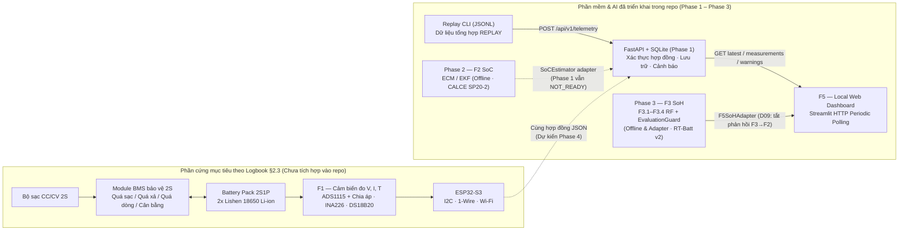
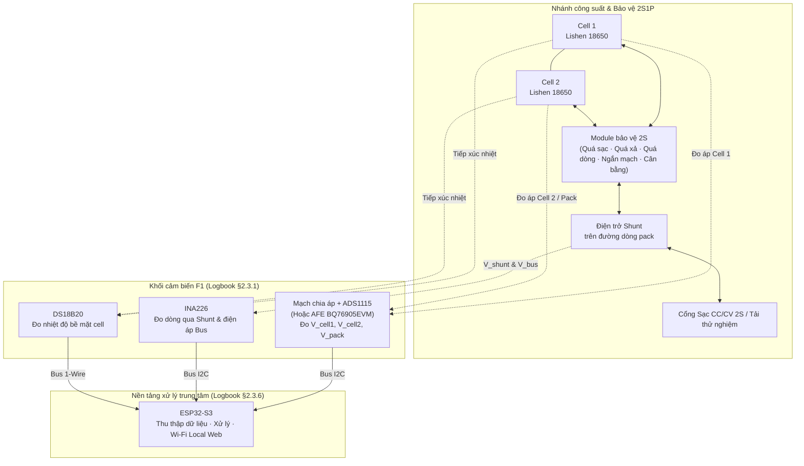
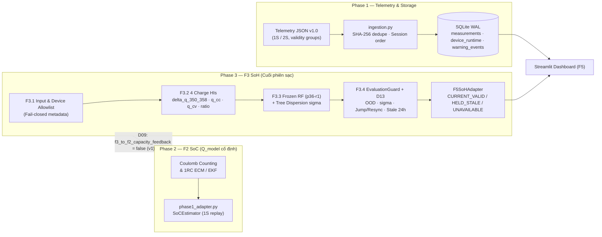

# SmartBMS-AI — Hệ thống Quản lý Pin Xe điện Ứng dụng Trí tuệ Nhân tạo (PBL5)

> **Đề tài:** Nghiên cứu và phát triển hệ thống quản lý pin xe điện ứng dụng trí tuệ nhân tạo  
> **Đơn vị:** Khoa Điện — Trường Đại học Bách khoa, Đại học Đà Nẵng (Lớp `22PFIEV2` · PBL5: Industrial Design Process)  
> **Nhóm thực hiện:** Trịnh Quang Khải · Lê Thanh Lâm · Nguyễn Quang Trường · Đoàn Anh Khoa  


[](phase1_bms_software/docs/VERIFICATION.md)
[](phase2_soc_delivery/results/p26_diagnostic_report.md)
[](phase3_soh_delivery/reports/P3_7_TEST_SUMMARY.md)
[-lightgrey)](#7-giới-hạn-hiện-tại-và-công-việc-tiếp-theo)

---

## 1. Tổng quan dự án và phạm vi hiện tại

**SmartBMS-AI** là dự án thiết kế và phát triển mô hình hệ thống quản lý pin Lithium-ion (Battery Management System – BMS) ở quy mô thử nghiệm với 5 khối chức năng chính từ Logbook (`F1`–`F5`):

- **F1 — Battery Monitoring:** Giám sát điện áp cell/pack (`V`), dòng sạc/xả (`I`), nhiệt độ (`T`) và kiểm tra tính hợp lệ dữ liệu đo.
- **F2 — State of Charge (SoC) Estimation:** Ước lượng SoC dựa trên mô hình mạch tương đương **ECM** kết hợp **Extended Kalman Filter (EKF)** và **Coulomb Counting** đối chứng.
- **F3 — State of Health (SoH) Estimation:** Ước lượng SoH theo dung lượng vận hành ở cuối mỗi phiên sạc bằng **Random Forest Regression** kèm lớp kiểm soát miền (`OOD`), độ bất định (`sigma_trees`), bước nhảy bất thường (`jump/resync`) và quá hạn thời gian (`D13`).
- **F4 — Abnormal Condition Detection:** Phát hiện quá áp (`OV`), quá dòng (`OC`), quá nhiệt (`OT`) theo ngưỡng có trễ và trễ hồi (Delay & Hysteresis).
- **F5 — Battery State Information:** Tiếp nhận, định dạng và hiển thị trạng thái pin cùng cảnh báo trên giao diện Web Dashboard (HTTP Periodic Polling).

> **Lưu ý về tính trung thực của trạng thái hiện tại:**  
> Kho lưu trữ này chứa **phần mềm prototype (Phase 1)** và **hai gói nghiên cứu/suy luận thuật toán đã kiểm chứng trên bộ dữ liệu công khai (Phase 2 SoC trên CALCE SP20-2; Phase 3 SoH trên RT-Batt v2)**. **Chưa có firmware ESP32-S3, chưa kết nối pin thật Lishen 18650 2S1P, và chưa triển khai mạch bảo vệ phần cứng trong repo này (`hardware_validated = false`).**

---

## 2. Kiến trúc hệ thống và sơ đồ khối mạch mục tiêu

### 2.1. Kiến trúc tổng thể hệ thống (F1–F5 & Ranh giới triển khai)

Sơ đồ dưới đây thể hiện kiến trúc tổng thể theo Logbook §2.2–§2.3, tách bạch rõ **khối phần cứng mục tiêu (chưa tích hợp)** và **các khối phần mềm / thuật toán đã triển khai trong repo**:



### 2.2. Sơ đồ khối mạch đo lường và bảo vệ mục tiêu 2S1P (Logbook §2.3.1)

Dựa trên kết quả lựa chọn linh kiện bằng AHP trong Logbook §2.3.1 & §2.3.6 (Bảng 2.13–2.18, Bảng 2.23), kiến trúc mạch đo lường và bảo vệ mục tiêu cho cấu hình **2S1P** gồm:



> **Ghi chú kỹ thuật:** Sơ đồ trên phản ánh đúng cấu trúc khối và giao tiếp (`I²C`, `1-Wire`, `Wi-Fi`) đã chốt bằng AHP trong Logbook §2.3. Các thông số chi tiết cấp schematic như giá trị điện trở chia áp, giá trị điện trở shunt, gán chân GPIO cụ thể và mạch cách ly đất chưa được chốt trong Logbook cũng như chưa kiểm nghiệm trên phần cứng thật, nên không được bịa thêm trong tài liệu này.

### 2.3. Luồng dữ liệu phần mềm và ranh giới F2 / F3 (Quyết định D09)



---

## 3. Đối chiếu Yêu cầu Kỹ thuật (ER1–ER7) từ Logbook

| Mã ER | Yêu cầu mục tiêu (Logbook §5.3) | Trạng thái hiện tại trong repo | Ghi chú bằng chứng |
|---|---|---|---|
| **ER1** | Sai số tương đối đo điện áp ≤ `±2%` | **Chưa kiểm chứng phần cứng** | Thuộc phần cứng F1.1 (chưa tích hợp mạch thật) |
| **ER2** | Sai số tương đối đo dòng sạc/xả ≤ `±3%` | **Chưa kiểm chứng phần cứng** | Thuộc phần cứng F1.2 (INA226 chưa tích hợp) |
| **ER3** | Sai số tuyệt đối đo nhiệt độ ≤ `±2 °C` | **Chưa kiểm chứng phần cứng** | Thuộc phần cứng F1.3 (DS18B20 chưa tích hợp) |
| **ER4** | Sai số tuyệt đối SoC ≤ `10 pp` | **`ER4_NOT_ASSESSABLE` (Phase 2 v1)** | Dev DST/FUDS MAX ≤ `1.89 pp`; Held-out US06/BJDST bị 356/35.737 mẫu `OUT_OF_DOMAIN` cuối xả (`z_pred < 0`) nên chưa đạt yêu cầu độ phủ 100% ([Chẩn đoán P2.6](phase2_soc_delivery/results/p26_diagnostic_report.md)) |
| **ER5** | Sai số tuyệt đối SoH theo dung lượng ≤ `10 pp` | **`ER5_PASS` trên RT-Batt v2 LFP 30 °C** | Held-out 19 cell / 37.130 phiên: Raw coverage `100.00%`, VALID coverage `95.84%`, Micro-MAX `4.6181 pp ≤ 10 pp` ([Báo cáo P3.7](phase3_soh_delivery/reports/P3_7_TEST_SUMMARY.md)). **Chưa xác minh trên Lishen 2S1P (`hardware_validated = false`)** |
| **ER6** | Phát hiện OV/OC/OT đạt `F1-score ≥ 0.85` | **Chưa triển khai bộ phát hiện F4** | Phase 1 mới lưu và hiển thị cảnh báo do nguồn telemetry cung cấp, chưa tự suy diễn ngưỡng an toàn |
| **ER7** | Hiển thị đủ 6 nhóm thông tin (V, I, T, SoC, SoH, cảnh báo) kèm tên & đơn vị | **Đã kiểm chứng luồng phần mềm** | Dashboard Phase 1 (`AT-18`, `AT-19` AppTest) và adapter F5 ở Phase 3 (`P3-IT-01`, `P3.8 = PASS`); chưa kiểm thử trực quan trình duyệt trên phần cứng thật |

---

## 4. Kết quả chi tiết từng Phase đã thực hiện

### 4.1. Phase 1 — Phần mềm BMS Prototype ([`phase1_bms_software/`](phase1_bms_software/README.md))

- **Kiến trúc:** FastAPI + SQLite (`1 worker`, chế độ `WAL`, giao dịch nguyên tử `BEGIN IMMEDIATE`) + công cụ phát lại JSONL (`replay.runner`) + giao diện Streamlit polling (`dashboard/app.py`).
- **Tính năng đã kiểm chứng:**
  - Hợp đồng HTTP/JSON v1.0 nghiêm ngặt (chặn `NaN`/`±Infinity`, ép kiểu ngầm, hỗ trợ vector 1S và 2S, che mờ nhóm cảm biến lỗi `INVALID_DATA` thay vì điền 0).
  - Xử lý trùng lặp idempotent bằng SHA-256 (`200 duplicate`), dữ liệu lịch sử (`202 accepted_historical`), xung đột định danh/uptime (`409`), trạng thái tươi theo thời gian nhận (`LIVE`/`STALE` biên 5 giây) và lưu chuyển trạng thái cảnh báo (`ACTIVATED`/`CLEARED`).
  - Các bộ ước lượng `SoCEstimator` / `SoHEstimator` ở Phase 1 giữ đúng stub `NotReadyEstimator` (`NOT_READY`, `value_pct = null`).
- **Bằng chứng kiểm thử:** **110 / 110 pytest PASS** trên Windows / Python `3.14.2` (`AT-01`–`AT-20` về luồng phần mềm, bao gồm Uvicorn subprocess và Streamlit AppTest; xem [VERIFICATION.md](phase1_bms_software/docs/VERIFICATION.md)).

### 4.2. Phase 2 — Ước lượng SoC bằng ECM / EKF ([`phase2_soc_delivery/`](phase2_soc_delivery/PHASE1_COMPATIBILITY.md))

- **Miền dữ liệu:** Bộ dữ liệu **CALCE SP20-2** ở 25 °C (dung lượng khóa `2.028344937765965 Ah`, mô hình OCV đơn điệu trên `[0, 1]` tắt ngoại suy, mô hình mạch tương đương `1RC ECM`).
- **Kết quả tập phát triển P2.5 (`FULL_DYNAMIC`, 100% độ phủ):**

| Kịch bản phát triển (P2.5) | Mẫu có SoC / Tổng | MAE (pp) | RMSE (pp) | P95 (pp) | MAX (pp) |
|---|---:|---:|---:|---:|---:|
| `11_05_2015_SP20-2_DST_50SOC` | 6.698 / 6.698 | 0.6195 | 0.7703 | 1.3276 | 1.7614 |
| `11_05_2015_SP20-2_DST_80SOC` | 10.645 / 10.645 | 0.8551 | 0.9666 | 1.7676 | 1.8884 |
| `11_06_2015_SP20-2_FUDS_80SOC` | 11.098 / 11.098 | 0.6149 | 0.7432 | 1.3440 | 1.8295 |
| `11_09_2015_SP20-2_FUDS_50SOC` | 6.999 / 6.999 | 0.5986 | 0.7485 | 1.5816 | 1.8701 |

- **Kết quả đánh giá held-out P2.6 (`US06` & `BJDST` ở 50% / 80% SoC):**
  - Tổng cộng **35.737** sự kiện, EKF xuất kết quả hợp lệ ở **35.381 / 35.737 (99.00%)**, có **356** sự kiện `OUT_OF_DOMAIN` đều xảy ra ở cuối pha xả khi dự đoán `z_pred < 0` trước bước chiếu biên (không có mẫu nào vượt miền dòng điện).
  - Theo quy tắc độ phủ 100% cho từng lượt của giao thức P2.6, trạng thái nghiệm thu được giữ trung thực là **`ER4_NOT_ASSESSABLE`** (`test_exposed = true`, `scientific_release = false`), yêu cầu quay lại `P2.3` dưới kiểm soát thay đổi cho phiên bản tiếp theo ([p26_diagnostic_report.md](phase2_soc_delivery/results/p26_diagnostic_report.md)).
- **Tương thích Phase 1:** Đã triển khai và kiểm thử `src/phase1_adapter.py` khớp chữ ký `SoCEstimator.estimate` và schema `EstimationResult` của Phase 1 mà không làm thay đổi mã nguồn Phase 1 ([PHASE1_COMPATIBILITY.md](phase2_soc_delivery/PHASE1_COMPATIBILITY.md)).

### 4.3. Phase 3 — Ước lượng SoH bằng Random Forest ([`phase3_soh_delivery/`](phase3_soh_delivery/reports/P3_7_TEST_SUMMARY.md))

- **Nguồn dữ liệu & nhãn (`D01`–`D05`):**
  - **RT-Batt v2 / HUST** (`DOI: 10.17632/nsc7hnsg4s.2`, giấy phép `CC BY 4.0`, cell LFP `A123_APR18650M1A` 1.1 Ah ở 30 °C): 77 cell gốc, 146.122 chu kỳ, 91.736.659 hàng tín hiệu được chuyển đổi an toàn qua container Docker cô lập (`D11`, image `d11-r1`).
  - **Nhãn vận hành (`D02`/`D03`):** 143.863 nhãn trên 76 cell (loại cell `7-5` khỏi tập nhãn v1), chia theo cell cố định `57 cell development` (106.733 phiên, 5-fold GroupKFold) và `19 cell held-out` (37.130 phiên, mở duy nhất 1 lần ở P3.7).
  - **4 đặc trưng cuối phiên sạc (`p35-r1` / `D04`):** `delta_q_350_358_ah`, `q_cc_ah`, `q_cv_ah`, `q_cv_over_q_cc` (không sử dụng dữ liệu xả tương lai hay thông tin commissioning).
- **So sánh mô hình (Development 5-fold CV vs Held-out `FULL_ELIGIBLE` 37.130 phiên):**

| Mô hình / Ablation (`p36-r1`) | Dev 5-fold Macro-MAE (pp) | Held-out Raw Macro-MAE (pp) | Ghi chú |
|---|---:|---:|---|
| `train_median` | 5.9061 | 6.0503 | Baseline sanity |
| `ridge` | 0.7884 | 1.1030 | Baseline tuyến tính bắt buộc (`D08`) |
| **`rf` (cell-balanced, mô hình chính `D06`)** | **0.7015** | **0.8973** | **28.577.815 byte** (≤ 50 MB) |
| `rf_unweighted` | 0.7044 | 0.8891 | Ablation không trọng số cell |
| `xgb` (`FIXED_CV_N_ESTIMATORS = 200`, `D15`) | 0.7012 | 0.9044 | Đối chứng cây tăng cường |
| `voltage_window_only` (1 HI) | 6.0388 | 6.1584 | Chỉ `delta_q_350_358_ah` |
| `cc_cv_only` (2 HI) | 0.7544 | 1.0053 | `q_cc_ah`, `q_cv_ah` |
| `phase_and_ratio` (3 HI) | 0.7764 | 1.0125 | `q_cc_ah`, `q_cv_ah`, `q_cv_over_q_cc` |

- **Kết quả nghiệm thu Held-out P3.7 (`ER5_PASS` theo `D07`, đã ký `PASS / TEST_REPORTED`):**
  - Toàn tập `FULL_ELIGIBLE` (37.130 phiên / 19 cell): độ phủ Raw **`100.00%`**, độ phủ VALID **`95.84%`** (35.586 phiên; 632 `OUT_OF_DOMAIN`, 912 `MODEL_UNCERTAIN`, 0 jump/resync/missing HI).
  - Sai số RF: Macro-MAE Raw **`0.8973 pp`** (VALID `0.9032 pp`), Micro-P95 **`3.1942 pp`**, **Micro-MAX `4.6181 pp` ≤ `10.0 pp`** trên toàn bộ 19 cell.
  - Chẩn đoán 2 dải SoH tham chiếu (`D16`): `SOH ≥ 80%` (32.256 phiên, VALID `95.95%`, Raw MAX `4.6181 pp`) và `SOH < 80%` (4.874 phiên, VALID `95.10%`, Raw MAX `3.7969 pp`).
  - 3 cell có độ phủ VALID dưới 90% được ghi nhận minh bạch để thiết kế cơ chế giữ giá trị gần nhất trên F5: cell `9-6` (`75.24%`), `10-2` (`82.09%`), `8-6` (`84.19%`) ([P3_7_FAILURE_ANALYSIS.md](phase3_soh_delivery/reports/P3_7_FAILURE_ANALYSIS.md)).
- **Kết quả đóng gói & tích hợp P3.8 (đã ký `PASS / INFERENCE_VERIFIED` & duyệt `D13` online ngày `2026-11-23T21:30:50+07:00`):**
  - Parity 100% trên 37.130 phiên P3.7 (0 lệch trạng thái, sai lệch SoH lớn nhất `5.68 × 10⁻¹⁴ pp`) và 25 chu kỳ staging cell `1-1` (`ΔHI = 0`).
  - Chính sách `D13` online: ngưỡng tuổi quan sát tối đa **`86.400` giây** (24 giờ), dung sai tương lai **`5` giây**, thiếu/naive `observed_at` hoặc `now_utc` trả `STALE`, và `F5SoHAdapter` tự tính lại tuổi khi đọc/hiển thị để chuyển `HELD_STALE` sau 24 giờ không có phiên sạc mới.
  - Allowlist thiết bị fail-closed (`NOT_VALIDATED_FOR_DEVICE` khi sai model hoặc bỏ trống metadata thiết bị), cưỡng chế `f3_to_f2_capacity_feedback = false` (`P3-IT-02` PASS theo `D09`), kiểm chứng tương thích schema Phase 1 (`4/4` PASS), và suite kiểm thử **71 đạt, 2 ca legacy bỏ qua, 0 lỗi** ([P3_8_INTEGRATION_TEST.md](phase3_soh_delivery/reports/P3_8_INTEGRATION_TEST.md) · [P3_APPROVAL_REGISTER.md](phase3_soh_delivery/decisions/P3_APPROVAL_REGISTER.md)).
  - Mốc **`P3.9`** (kiểm tra tái lập môi trường sạch và đóng gói evidence bundle v1) hiện ở trạng thái **`IN_PROGRESS`**.

---

## 5. Cấu trúc kho lưu trữ

```text
SmartBMS-AI/
├── phase1_bms_software/         # Phase 1: FastAPI + SQLite + Replay CLI + Streamlit UI
│   ├── app/                     # API, schema nghiêm ngặt, ingestion, SQLite repo, state, estimator stubs
│   ├── dashboard/               # Client httpx + giao diện Streamlit polling
│   ├── replay/                  # CLI phát lại telemetry tổng hợp JSONL
│   ├── sample_data/             # 3 bộ fixture tổng hợp (1S, 2S, sensor fault/recovery)
│   ├── docs/                    # ARCHITECTURE, API, DATA_CONTRACT, VERIFICATION, decisions
│   └── tests/                   # 110 bài test tự động (pytest)
├── phase2_soc_delivery/         # Phase 2: SoC Estimation (CALCE SP20-2 · ECM / EKF)
│   ├── src/                     # cc.py, ekf.py, development_data.py, final_evaluation.py, phase1_adapter.py
│   ├── artifacts/               # ocv_model.json, ocv_table.csv, ecm_params.json, capacity_metadata.json
│   ├── configs/                 # Cấu hình tìm kiếm P2.5, giao thức khóa P2.6, policy G10
│   ├── approvals/ & changes/    # Biên bản phê duyệt và yêu cầu thay đổi P2.3
│   ├── results/                 # Metrics, runs, claims, báo cáo P2.5 và chẩn đoán P2.6
│   ├── notebooks/ & tests/      # Notebook tái lập và bộ test (gồm test_phase1_adapter.py)
│   └── run_cc.py · run_ekf.py · run_heldout.py
└── phase3_soh_delivery/         # Phase 3: SoH Estimation (RT-Batt v2 · Random Forest)
    ├── src/soh/                 # feature_extractor, evaluation_guard, inference, ood, output_validation, f5_adapter
    ├── contracts/               # soh_inference.schema.json (JSON Schema Draft 2020-12)
    ├── artifacts/soh/           # feature_schema.json, ood_policy.json, model_manifest.json, model_card.md
    ├── conversion/              # Dockerfile D11, bộ chuyển đổi cô lập và script xác minh staging
    ├── configs/ & decisions/    # Chính sách huấn luyện/ER5 và sổ phê duyệt P3_APPROVAL_REGISTER.md
    ├── manifests/ & reports/    # Biên bản kiểm chứng P3.1–P3.8, log test, bảng kết quả & sổ tiến độ
    ├── scripts/ & tests/        # Pipeline tái lập P3.1–P3.8 và bộ kiểm thử unittest
    └── checksums.sha256
```

> **Dữ liệu lớn và tệp nhị phân:** Tập gốc RT-Batt v2 (`our_data.zip`, `1.188.136.932` byte, DOI `10.17632/nsc7hnsg4s.2`, SHA-256 `071d24617153693b0d29059568525e620f6af6512acc9d00c98c7adcf15125db`), dữ liệu staging/processed Parquet, quỹ đạo `.csv.gz` và các tệp model `.joblib` (`rf_model.joblib` 28,58 MB cùng các bản ablation) không lưu trong lịch sử Git để giữ repo nhẹ. Mọi mã băm SHA-256 đối chiếu được giữ nguyên trong thư mục `manifests/` và `artifacts/` của từng phase.

---

## 6. Hướng dẫn cài đặt và chạy nhanh (Windows PowerShell)

### 6.1. Chạy thử Prototype Phần mềm Phase 1

```powershell
# 1. Tạo môi trường ảo và cài thư viện (Python 3.11+, đã kiểm chứng trên 3.14.2)
Set-Location 'phase1_bms_software'
python -m venv .venv
.\.venv\Scripts\python.exe -m pip install -r requirements.txt
Copy-Item .env.example .env

# 2. Chạy Backend FastAPI (Terminal 1)
.\.venv\Scripts\python.exe -m uvicorn app.main:app --host 127.0.0.1 --port 8000 --workers 1

# 3. Chạy Dashboard Streamlit (Terminal 2)
.\.venv\Scripts\python.exe -m streamlit run dashboard/app.py --server.address 127.0.0.1 --server.port 8501 --server.headless true

# 4. Phát lại dữ liệu mẫu tổng hợp 2S (Terminal 3)
.\.venv\Scripts\python.exe -m replay.runner --file sample_data/telemetry_2s.jsonl --url http://127.0.0.1:8000 --rate-hz 1

# 5. Chạy toàn bộ 110 bài kiểm thử Phase 1
.\.venv\Scripts\python.exe -m pytest -q
```

### 6.2. Chạy kiểm thử tương thích Phase 2 SoC

```powershell
Set-Location 'phase2_soc_delivery'
# Kiểm thử đơn vị SoC (cần numpy, scipy, pytest)
python -m pytest -q tests/test_cc.py tests/test_ekf.py tests/test_ekf_replay.py tests/test_final_evaluation.py

# Kiểm thử tương thích giao diện SoCEstimator với Phase 1
$env:PYTHONPATH = (Resolve-Path '..\phase1_bms_software').Path
..\phase1_bms_software\.venv\Scripts\python.exe -B -m pytest -W error -p no:cacheprovider -q tests/test_phase1_adapter.py
```

### 6.3. Chạy kiểm thử Phase 3 SoH

```powershell
Set-Location 'phase3_soh_delivery'
python -m venv .p36_env
.\.p36_env\Scripts\python.exe -m pip install -r configs/p3_training_requirements.txt

# Chạy các kiểm thử logic không phụ thuộc tệp .joblib / dữ liệu lớn
$env:PYTHONPATH = "$PWD;$PWD\scripts"
.\.p36_env\Scripts\python.exe -B -m unittest tests/test_evaluation_guard.py tests/test_p35.py tests/test_p37.py tests/test_source_security.py -v
```

*(Để chạy đầy đủ `tests/test_p38.py` và `scripts/verify_p38.py`, cần đặt đúng tệp `artifacts/soh/rf_model.joblib` và dữ liệu staging/held-out có mã SHA-256 khớp [model_manifest.json](phase3_soh_delivery/artifacts/soh/model_manifest.json).)*

---

## 7. Giới hạn hiện tại và công việc tiếp theo

- **Phần cứng & an toàn vật lý (`hardware_validated = false`):** Chưa có firmware ESP32-S3, chưa hiệu chuẩn cảm biến `ADS1115`/`INA226`/`DS18B20`, chưa tích hợp mạch bảo vệ 2S và chưa kiểm chứng trên cell **Lishen 18650 2S1P**.
- **Phase 2 SoC (`ER4_NOT_ASSESSABLE`):** Cần quay lại `P2.3` dưới kiểm soát thay đổi để xử lý hành vi dự đoán EKF tại biên cuối xả (`z_pred < 0`) và xác minh lại chuẩn dựng SoC tham chiếu trên tập kiểm thử độc lập mới.
- **Phase 3 SoH (`P3.9 = IN_PROGRESS`):** Hoàn tất lần chạy tái lập trong môi trường sạch từ `our_data.zip` theo route Docker `D11`, xuất bộ hồ sơ bàn giao cuối (`P3_FINAL_REVIEW.md`, `P3_HANDOFF_TO_BODY.md`, `release_manifest.json`, gói ZIP kiểm chứng), và hoàn thiện metadata các quyết định quản trị còn mở (`D01`, `D10`, `D11`, `D14`) trong [P3_APPROVAL_REGISTER.md](phase3_soh_delivery/decisions/P3_APPROVAL_REGISTER.md).
- **Ranh giới F2/F3 (`D09`):** Phản hồi dung lượng từ F3 sang F2 (`f3_to_f2_capacity_feedback`) tắt hoàn toàn trong v1; chỉ xem xét mở lại ở giai đoạn sau khi có dữ liệu thực nghiệm xác minh trên pin mục tiêu.
