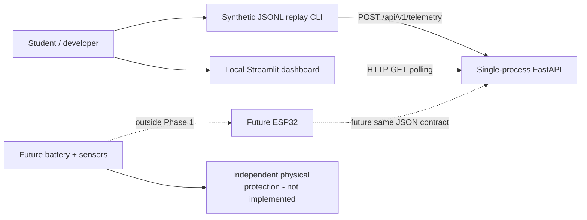
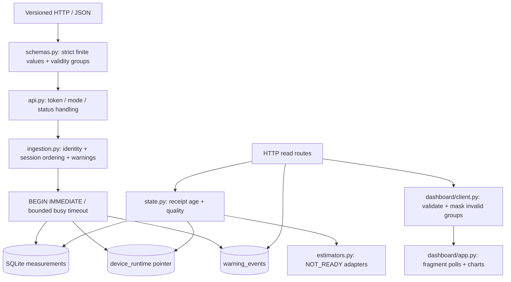

# Phase 1 architecture

Authority: PBL5-SD-001 v1.0. Software prototype only. No hardware connection/control, protective actions or ML implementation.

## Context



There is no application control path to a battery or its protection circuit. HARDWARE is a reserved input-origin contract, not an implemented hardware adapter.

## Components and data flow



All ingestion decisions and writes are inside one SQLite transaction; acknowledgement is returned after commit. A connection belongs to one unit of work and closes in finally. Initialization creates four tables idempotently, enables WAL, and every connection enables foreign keys and finite busy_timeout. There are no application-level unbounded retries; SQLite waits at most the configured busy timeout for a lock. Disk/DB errors become 503.

Identity is unique in SQLite. Canonical validated JSON and SHA-256 define duplicate content. Previously observed sessions are inferred from persistent measurements, so a process restart cannot reactivate a retired session. New session IDs become current immediately; backfills never advance latest or warnings.

The dashboard holds only an optional last-known response for disconnected presentation. SQLite is authoritative. The UI does not import the repository or open SQLite. Backend restarts recover latest state and warning history from the same file.

## Sequence

```mermaid
sequenceDiagram
  participant R as Replay CLI
  participant A as FastAPI
  participant D as SQLite
  participant S as Streamlit
  R->>A: POST /api/v1/telemetry (REPLAY)
  A->>A: Strict schema, configured token, source/mode checks
  A->>D: BEGIN IMMEDIATE
  A->>D: Identity lookup; session + uptime checks
  A->>D: Insert measurement
  opt Current sample
    A->>D: Warning transitions + runtime pointer update
  end
  A->>D: COMMIT
  A-->>R: 201 / 200 duplicate / 202 historical
  S->>A: GET latest, measurements, warnings
  A->>D: Read persisted state/history
  A-->>S: Source, freshness, quality, NOT_READY/null
```

## Module interfaces

| Module | Interface / responsibility |
|---|---|
| config | Settings.from_env(); project-relative database path, validated demo settings |
| schemas | Telemetry, Ack, LatestState, MeasurementPage, WarningPage, EstimationResult |
| repository | initialize(), transaction(), latest(), measurements(), warning_events(), check_health() |
| ingestion | ingest(repo, payload, mode, clock) -> Ack; IngestionConflict |
| estimators | SoCEstimator / SoHEstimator Protocol; NotReadyEstimator.estimate(data, config) |
| state | latest_state(repo, device_id, clock, threshold, soc, soh) -> LatestState |
| main | create_app(settings=None, clock=utc_now, soc=None, soh=None) -> FastAPI |
| replay | load_records(path); run_replay(records, url, rate, client=..., sleep=...) |
| dashboard/client | fetch_snapshot(..., client=...) -> Snapshot; chart_rows(history) masks invalid groups |

Estimator protocols have intentionally unspecified future input/config types. Phase 1 substitutes only NotReadyEstimator; no parameters, model features, OCV data or fake historical training inputs exist. Invalid current telemetry bypasses estimator calls. NOT_READY results are not persisted.

## Operational bounds

Use one Uvicorn worker and loopback binding. Poll 2 s, stale after 5 s, replay 1 Hz are configurable software demo values. History is receipt-ID order, not source measurement time; charts explicitly show receipt UTC. Three dashboard GETs are sequential, not a transactional cross-endpoint snapshot. A sample may arrive between them. No cross-process caches, brokers, remote services or migrations framework.
